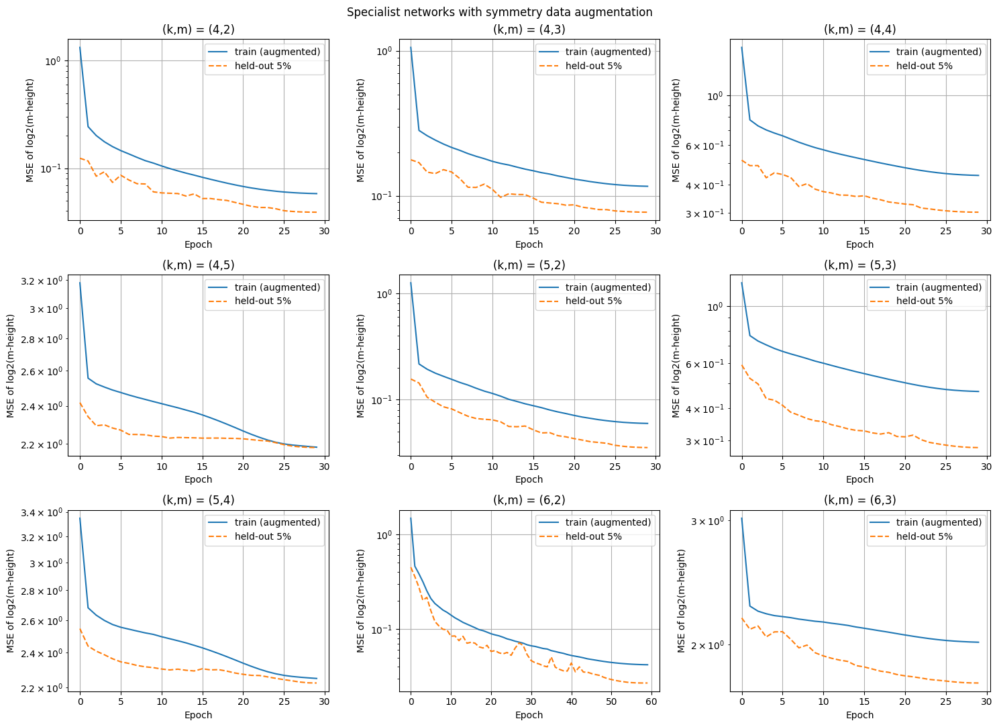

# Deep Neural Network Height-Prediction

Deep neural networks that predict the **m-height** of analog error-correcting codes from `(n, k, m, P)`, where the code is generated by `G = [I_k | P]` (`n = 9`, `k ∈ {4,5,6}`, `m ∈ {2,…,n−k}`). The cost is `(log2 y − log2 ŷ)²`, so every network predicts `z = log2(y)` and is trained with MSE on `z`. (CSCE 636, Project 1.)

| Version | Notebook | Validation cost (log2 MSE) |
|---|---|---|
| v1 | `Project1ver1.ipynb` | 0.620 |
| **v2** | **`Project1ver2.ipynb`** | **0.594** |

---

## Project Overview

### 📍 Situation
The m-height spans several orders of magnitude, and it depends on `P` in a highly non-linear way. In v1, a single MLP reached about 0.62 (log2 MSE), with training and validation losses almost equal. So the model was **under-fitting**: more epochs or regularization would not help.

### 🎯 Task
Lower the validation cost while following the project rules: all learning is done by DNNs, pre-/post-processing stays minimal, and no hand-crafted matrix features or linear-algebra functions are used.

### 🛠️ Action
1. **Per-group error analysis.** Measuring the cost separately for each `(k, m)` showed that the three groups with `m = n − k` cause about 80% of the error. For those groups the m-height is a ratio of determinants of sub-matrices of `G`, so it jumps sharply near singular sub-matrices.
2. **Loss = metric, ensemble.** Dropout was removed (the model was under-fitting), the loss was changed from log-cosh to MSE (the grading cost itself), and 3 networks trained with different seeds were averaged with a Keras `Average` layer.
3. **Specialist networks.** One residual MLP per `(k, m)`, whose input is only that group's `P` (no zero-padding).
4. **Symmetry data augmentation (training only).** Permuting the rows or columns of `P`, or flipping the sign of a row or column, gives an equivalent code with *exactly* the same m-height (verified with the LP algorithm). Each training matrix is copied 5–10× with random permutations and sign flips. This removed the specialists' over-fitting; for `(6,2)` the held-out cost went from 0.13 to 0.03.
5. **Mixture of experts.** For each `(k, m)`, the ensemble, the specialist, or their average is chosen on the validation set and stored in `routing.json`. The final cell routes every test sample to the network(s) chosen for its group.

### 📊 Result
Validation cost per `(k, m)` (100,000 held-out samples):

| (k, m) | (4,2) | (4,3) | (4,4) | (4,5) | (5,2) | (5,3) | (5,4) | (6,2) | (6,3) | overall |
|---|---|---|---|---|---|---|---|---|---|---|
| ensemble | 0.052 | 0.089 | 0.297 | 2.129 | 0.059 | 0.271 | 2.204 | 0.130 | 1.785 | 0.609 |
| **final** | **0.040** | **0.077** | **0.292** | **2.129** | **0.035** | **0.270** | **2.197** | **0.029** | **1.768** | **0.594** |

* Augmented specialists improve every "easy" group, most of all `(6,2)` (4.5× lower) and `(5,2)`.
* The `m = n − k` groups stay hard (≈ 1.8–2.2) for every architecture tried.
* Tried and rejected: multiplicative (`layers.Multiply`) layers with 1.5M extra LP-generated samples (0.669), and symmetry augmentation for the shared MLP (worse, because that model was under-fitting).



---

## Pipeline

```text
                         ┌─► [Ensemble: 3 residual MLPs, Average] ─────────────┐
[n, k, m, P] ─► route by (k, m)                                                 ├─► z_hat ─► 2^z_hat ─► y_hat (≥ 1)
                         └─► [Specialist MLP for (k, m), trained w/ augmentation] ┘
                              (routing.json: ensemble / specialist / average)
```

## Files
* `Project1ver1.ipynb` — first version.
* `Project1ver2.ipynb` — final version: training, evaluation and the final prediction cell (Google Colab, GPU).
* `figures/` — training curves.
* `CHANGELOG.md` — version history.

The course data and the trained model files are not included: `best_model.keras` is ≈ 1.7 GB and each `expert_k*_m*.keras` is ≈ 126 MB, which exceeds GitHub's 100 MB file limit.
